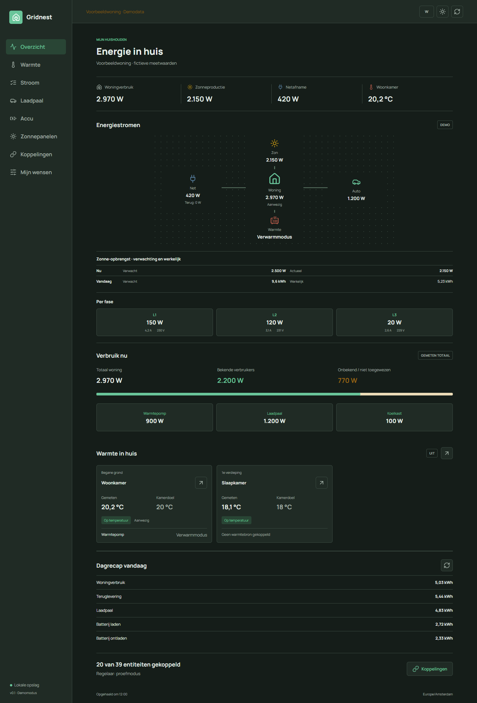

# Gridnest

Een zelfstandig, lokaal EMS-project voor Nederlandse huishoudens, gebouwd rond Home Assistant.

## Voorbeeld

De startpagina met fictieve demo-entiteiten en meetwaarden, zonder persoonlijke Home Assistant-gegevens.



## Gridnest 2.0

- Entiteiten uit de eigen Home Assistant selecteren op naam, type en eenheid.
- Netafname, teruglevering, zonnepanelen, kamertemperatuur, verwarming, laadvermogen, batterijlading en aanwezigheid uitlezen.
- Getekend netvermogen ondersteunen, met instelbare richting: positief afname en negatief export, of andersom.
- Woningverbruik direct meten of uit een complete energiebalans berekenen; bekend en niet-toegewezen verbruik uitsplitsen.
- Bekende verbruikers kiezen als losse apparaatmetingen of een bestaande totaalsensor, zonder beide op te tellen.
- Verwarmingsprofielen met algemeen advies voor vloerverwarming, airco en radiatoren.
- Kamers aanmaken per verdieping met temperatuur, aanwezigheid en gewenst doel; meerdere gedeelde warmtebronnen per kamer koppelen.
- Warmtebronregeling vanuit het kamerdoel, met eigen proefmodus/activering en optionele begrensde zonnevoorverwarming voor airco's.
- Comforttemperaturen, aanwezigheidstijden, netlimiet en laadbehoefte lokaal bewaren.
- V1-regelbouwer met eigen als/dan/anders-logica voor verwarming, laadpaal, batterij en PV-begrenzing; geen AI-beslissingen.
- Uit, proefmodus en expliciet vrijgegeven actieve sturing; demo verstuurt nooit opdrachten.
- Automatische regelcyclus met apparaatgrenzen, bevestigingscontrole, handmatige pauze en blokkering bij ontbrekende data.
- Een expliciete demomodus met fictieve entiteiten, gescheiden van echte koppelingen.
- Financieel overzicht met vaste en dynamische tarieven, laag/hoog-meterkoppelingen, 45-daagse prijshistorie en dynamische vooruitblik.
- Toekomstige vaste prijzen plannen met een ingangsdatum; water gebruikt een vast tarief.

## Repository

`repository.yaml` staat in de repositoryroot. De add-on, Dockerfile, applicatie en tests staan in `ems/`. De add-on heet **Gridnest** en heeft de stabiele slug `gridnest`.

De GitHub-workflow test en bouwt de interface en controleert containers voor amd64 en aarch64. Alleen een expliciete `v*`-versietag publiceert een multi-architectuurimage naar GHCR, na tests en container-smoke-tests. De tag moet overeenkomen met de pakketversie.

De publieke bronrepository staat op [github.com/Thedeed99/gridnest](https://github.com/Thedeed99/gridnest). Voeg deze URL in Home Assistant toe via **Instellingen > Add-ons > Add-on Store > menu > Repositories**. Omdat `ems/config.yaml` geen `image` opgeeft, bouwt Home Assistant de add-on vanuit de bronrepository. Expliciete `v*`-releasetags publiceren daarnaast een multi-architectuurimage naar GHCR.

## Lokaal ontwikkelen

Node.js 22 of nieuwer:

```powershell
cd ems
npm ci
npm test
npm run build
$env:DEMO_MODE = 'true'
npm start
```

Open `http://localhost:8080`. De ontwikkelserver luistert standaard uitsluitend op localhost. Instellingen staan in `ems/data/`; deze map wordt niet opgenomen in Git.

Voor een echte Home Assistant Container-verbinding: schakel demomodus uit, stel `HA_URL` in op het API-adres (bijvoorbeeld `http://homeassistant:8123/api`) en lever `HA_TOKEN` als omgevingsvariabele aan. Zet nooit sleutels in broncode, browserinstellingen of de repository. In de add-on levert Supervisor zelf `SUPERVISOR_TOKEN` aan.

Actieve sturing is in deze versie uitsluitend toegestaan via de Home Assistant-app met Supervisor en Ingress. Geef de appoptie `allow_control` expliciet vrij en controleer de regels eerst in proefmodus. De gekozen stand blijft behouden bij opslaan en herstarten, totdat de gebruiker deze wijzigt. Actieve sturing kan na een herstart automatisch hervatten zodra apparaatvrijgave en geldige meetgegevens beschikbaar zijn. Een los draaiende container kan wel monitoren en regels beoordelen, maar geen live-opdrachten uitvoeren.

Er zijn nog geen containers of echte apparaten live getest in deze ontwikkelomgeving. Gebruik de experimentele regels niet als vervanging voor fabrikantbeveiligingen, fasebeveiliging of batterij-BMS-grenzen.

Voor de eerste lokale Home Assistant OS-pilot is een bronpakket voorbereid. De [pilotprocedure](docs/pilot.md) beschrijft installatie, proefmodus en de vereiste controles voordat echte sturing wordt vrijgegeven. Het pakket is geen publieke Store-release.

## Store-route

Een eigen repository toevoegen aan de Home Assistant Store is niet hetzelfde als opname in een officiële of communitycatalogus. De bronrepository is publiek. De projectcode blijft auteursrechtelijk beschermd: alle rechten voorbehouden en geen licentie voor hergebruik of verdere distributie verleend.

Zie [publicatiechecklist](docs/publication.md), [ontwikkelrichting](docs/roadmap.md) en [add-ondocumentatie](ems/DOCS.md).

## Copyright

Copyright (c) 2026 Gridnest. Alle rechten voorbehouden.

Zie [COPYRIGHT](COPYRIGHT). Deze vermelding verleent geen licentie voor hergebruik of distributie. Afhankelijkheden van derden behouden hun eigen licenties en copyrightvermeldingen.